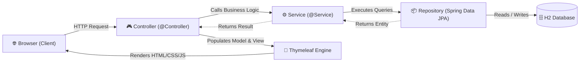

# ApexEMS - Enterprise Employee Management System

> A full-stack, enterprise-grade Employee Management System built with **Spring Boot 3**, **Thymeleaf**, **Spring Data JPA / Hibernate**, and an **embedded persistent H2 database**. Designed to be clean, maintainable, and beginner-friendly for developers learning Java and modern Spring ecosystem best practices.

---

## Table of Contents
1. [Project Overview](#1-project-overview)
2. [Features](#2-features)
3. [Tech Stack](#3-tech-stack)
4. [Project Structure](#4-project-structure)
5. [How the Application Works (Architecture & Data Flow)](#5-how-the-application-works)
6. [How to Run the Application](#6-how-to-run-the-application)
7. [Database Information & H2 Console](#7-database-information--h2-console)
8. [API & Web Routes](#8-api--web-routes)
9. [Screenshots Section (UI Showcase)](#9-screenshots-section)
10. [Future Improvements](#10-future-improvements)

---

## 1. Project Overview

**ApexEMS** is a complete, production-ready human resources and employee records management portal. It solves common workforce administration challenges by providing HR teams and engineering managers with an intuitive admin dashboard, granular employee directories, dynamic multi-attribute search and filtering, and full CRUD (Create, Read, Update, Delete) capabilities.

The project strictly follows the **Layered Architecture pattern** (`Controller -> Service -> Repository -> Database`), separating business rules from web concerns and persistence mechanisms. It serves as an exemplary baseline project for job interviews, university submissions, and personal learning.

---

## 2. Features

### 📊 Modern Executive Dashboard
- **Key Metric KPI Cards**: Real-time counts for total employees, active business departments, average salary per employee, and total company payroll.
- **Department Breakdown Grid**: Visual pills indicating headcount per business department.
- **Recent Joiners Table**: Highlights the 5 most recently onboarded employees with rapid action buttons.
- **Gamified Team Status**: Visual indicator of organizational operational health.

### 👥 Comprehensive Employee Directory
- **Rich Data Table**: Displays Employee ID, Full Name with custom color-hashed initial avatars, Contact Email, Phone Number, Department Badge, Job Title, Formatted Salary ($ USD), and Joining Date.
- **Instant Search**: Real-time query matching across first name, last name, full name, email, department, and job title.
- **Department Filter**: Dropdown to instantly isolate members belonging to specific business units (Engineering, Finance, HR, etc.).
- **Empty State Displays**: Contextual fallback graphics and reset shortcuts when no matching records are found.

### ➕ Add & Edit Records (With Validation)
- Full form support for first name, last name, email, phone, department, job title, salary, and joining date.
- **Server-Side Validation**:
  - `@NotBlank` & `@Size` checks on text fields.
  - `@Email` format verification with uniqueness validation (preventing duplicate corporate emails).
  - `@Pattern` validation on phone formats.
  - `@Positive` / `@DecimalMin` validation ensuring salary is non-zero and properly formatted.
  - `@PastOrPresent` validation ensuring joining dates cannot be set in the future.
- **Inline Error Feedback**: User-friendly red error highlights placed directly under invalid input elements.

### 🗑️ Safe Deletion with Confirmation Modal
- Destructive deletion actions are guarded by a responsive JavaScript modal confirmation dialog displaying the employee's name and ID before executing the request.

### 📄 Detailed Profile View
- Dedicated employee profile card displaying complete credentials, employment status, tenure details, direct mailto links, and quick navigation.

### 🎨 Gamified SaaS UI/UX
- Responsive sidebar navigation (with mobile slide-out drawer).
- Real-time live clock in the top navigation header.
- CSS variables-based design system (no paid third-party dependencies).
- Auto-dismissing flash notifications (success/alert toast messages).

---

## 3. Tech Stack

### Backend
- **Java 21 LTS** (Compatible with Java 17+)
- **Spring Boot 3.3.4**
- **Spring Web (Spring MVC)**: REST and HTTP request routing
- **Spring Data JPA**: Repository pattern and abstraction over SQL
- **Hibernate 6**: Object-Relational Mapping (ORM)
- **Jakarta Bean Validation (Hibernate Validator)**: Model validation
- **Apache Maven 3.9+**: Build tool and dependency manager

### Frontend
- **Thymeleaf**: Server-side template engine integrated into Spring Boot
- **HTML5 & Modern CSS3**: Accessible form labels, flexbox/grid layouts, CSS variables
- **Vanilla JavaScript (ES6+)**: Modal management, auto-dismissing alerts, real-time clock, mobile drawer toggle

### Database
- **H2 Database**: Embedded file-based SQL database (`./data/emsdb`) providing persistence across restarts with an active web console at `/h2-console`.

---

## 4. Project Structure

```text
Employee-managment-system/
├── pom.xml                               # Maven project definition and dependencies
├── mvnw / mvnw.cmd                       # Maven wrapper execution scripts
├── .gitignore                            # Git ignore configuration
├── README.md                             # Documentation and walkthrough guide
│
├── data/                                 # Persistent H2 database storage directory
│   └── emsdb.mv.db
│
├── src/
│   ├── main/
│   │   ├── java/com/ems/
│   │   │   ├── EmployeeManagementSystemApplication.java  # Main application entry point
│   │   │   │
│   │   │   ├── entity/
│   │   │   │   └── Employee.java                         # JPA Entity mapped to "employees" table
│   │   │   │
│   │   │   ├── repository/
│   │   │   │   └── EmployeeRepository.java               # Spring Data JPA data access interface
│   │   │   │
│   │   │   ├── service/
│   │   │   │   ├── EmployeeService.java                  # Business logic interface
│   │   │   │   └── impl/
│   │   │   │       └── EmployeeServiceImpl.java          # Service implementation with @Transactional
│   │   │   │
│   │   │   ├── controller/
│   │   │   │   ├── DashboardController.java              # Routes for "/" and "/dashboard"
│   │   │   │   └── EmployeeController.java               # CRUD routes for "/employees"
│   │   │   │
│   │   │   ├── dto/
│   │   │   │   ├── EmployeeDto.java                      # Form data carrier with validation
│   │   │   │   └── DashboardStatsDto.java                # Aggregated metrics for dashboard
│   │   │   │
│   │   │   ├── exception/
│   │   │   │   ├── EmployeeNotFoundException.java        # Custom 404 domain exception
│   │   │   │   └── GlobalExceptionHandler.java           # @ControllerAdvice error interceptor
│   │   │   │
│   │   │   └── config/
│   │   │       └── DataInitializer.java                 # Seeds initial sample records on start
│   │   │
│   │   └── resources/
│   │       ├── application.properties                    # Server, H2 DB, JPA & Thymeleaf config
│   │       ├── static/
│   │       │   ├── css/
│   │       │   │   └── style.css                         # Custom admin dashboard stylesheet
│   │       │   └── js/
│   │       │       └── app.js                            # Modal, toast & clock scripts
│   │       └── templates/
│   │           ├── dashboard.html                        # Main dashboard view
│   │           ├── fragments/
│   │           │   ├── sidebar.html                      # Reusable sidebar navigation
│   │           │   ├── header.html                       # Reusable top header & user badge
│   │           │   └── modal.html                        # Reusable delete confirmation modal
│   │           ├── employees/
│   │           │   ├── list.html                         # Directory table with search & filter
│   │           │   ├── form.html                         # Add/Edit employee form
│   │           │   └── details.html                      # Individual employee profile view
│   │           └── error/
│   │               ├── 404.html                          # Friendly not-found page
│   │               └── error.html                        # General error page
│   │
│   └── test/java/com/ems/
│       └── EmployeeManagementSystemApplicationTests.java # Full integration test suite
```

---

## 5. How the Application Works

Spring Boot follows the **Model-View-Controller (MVC)** and **Layered Architecture** design principles. Here is the step-by-step lifecycle of an HTTP request:



### Detailed Layer Responsibilities:
1. **Frontend / View (`templates/`)**: HTML5 pages powered by Thymeleaf expressions (`th:text`, `th:each`, `th:if`, `th:field`). Forms submit HTTP `POST` requests, and tables trigger `GET` queries.
2. **Controller Layer (`controller/`)**: Annotations like `@GetMapping` and `@PostMapping` catch incoming requests, extract parameters (`@RequestParam`, `@PathVariable`), trigger validation (`@Valid`), and decide which Thymeleaf template to render.
3. **Service Layer (`service/`)**: Contains the business logic of the enterprise application (e.g. verifying email uniqueness, calculating averages, formatting figures, and ensuring atomic transactions via `@Transactional`).
4. **Repository Layer (`repository/`)**: Extends `JpaRepository<Employee, Long>`. Spring automatically generates SQL statements (like `SELECT`, `INSERT`, `UPDATE`, `DELETE`) at runtime. Custom searches are handled with clean JPQL queries.
5. **Database Layer (`entity/` & H2)**: JPA entities are mapped to relational tables. Hibernate creates and updates tables automatically based on the entity definitions.

---

## 6. How to Run the Application

### Prerequisites
- **Java Development Kit (JDK) 17 or higher** installed (`java -version`).
- Terminal (PowerShell on Windows, Bash on macOS/Linux).

### Running with the Included Maven Distribution / Wrapper

1. **Clone or Navigate to the Project Root**:
   ```bash
   cd Employee-managment-system
   ```

2. **Run using Maven Wrapper**:
   - On **Windows (PowerShell or Command Prompt)**:
     ```cmd
     .\mvnw.cmd spring-boot:run
     ```
   - On **macOS / Linux**:
     ```bash
     ./mvnw spring-boot:run
     ```
   *(If you have system Maven installed, you can also simply run `mvn spring-boot:run`)*

3. **Access the Application**:
   Open your browser and navigate to:
   [http://localhost:8080](http://localhost:8080)

4. **Run Unit and Integration Tests**:
   ```bash
   .\mvnw.cmd test
   ```

---

## 7. Database Information & H2 Console

The system is configured with an **embedded file-based H2 Database** located at `./data/emsdb`. This means all employees created or edited are **saved persistently** to disk and remain intact even when you stop and restart the application.

### Accessing the Web-Based SQL Console:
- **Console URL**: [http://localhost:8080/h2-console](http://localhost:8080/h2-console)
- **Driver Class**: `org.h2.Driver`
- **JDBC URL**: `jdbc:h2:file:./data/emsdb`
- **User Name**: `sa`
- **Password**: *(leave blank)*

Click **Connect** to view raw database tables, inspect the `EMPLOYEES` schema, and execute manual SQL queries.

---

## 8. API & Web Routes

| HTTP Method | Route | Controller Method | Description |
|:---|:---|:---|:---|
| `GET` | `/` | `rootRedirect()` | Redirects root traffic directly to `/dashboard` |
| `GET` | `/dashboard` | `showDashboard()` | Displays metrics, department breakdown & recent joiners |
| `GET` | `/employees` | `listEmployees()` | Lists all employees with optional `keyword` and `department` query parameters |
| `GET` | `/employees/new` | `showCreateForm()` | Displays empty form to onboard a new employee |
| `POST` | `/employees` | `createEmployee()` | Validates and creates a new employee |
| `GET` | `/employees/{id}` | `showEmployeeDetails()` | Displays full profile card of employee with specified ID |
| `GET` | `/employees/edit/{id}` | `showEditForm()` | Displays pre-populated edit form for specified ID |
| `POST` | `/employees/update/{id}`| `updateEmployee()` | Validates and saves edits for specified ID |
| `POST` | `/employees/delete/{id}`| `deleteEmployee()` | Deletes the specified employee record |
| `GET` | `/h2-console` | *Spring Boot Built-in* | Interactive H2 Database management console |

---

## 9. Screenshots Section

### 1. Executive Dashboard
*Displays high-level workforce metrics, department distribution cards, and recent additions.*
```
+-----------------------------------------------------------------------------------------+
| [⚡ ApexEMS]                                                [🕒 Mon, Sep 27] [Admin AD]  |
+---------------+-------------------------------------------------------------------------+
| 📊 Dashboard   |  [👥 Total Workforce: 10]  [🏢 Departments: 7]  [💵 Avg Salary: $105k] |
| 👥 Employees   +-------------------------------------------------------------------------+
| ➕ Add New     |  🏢 Workforce Distribution: [Engineering: 3] [Product: 1] [Finance: 2]  |
| 🗄️ H2 Console |-------------------------------------------------------------------------|
|               |  ✨ Recent Employees:                                                   |
| [Team Health] |  #1  Sarah Jenkins   Engineering   $135,000.00   [👁️ View] [✏️ Edit] [🗑️] |
| Level 4       |  #2  Marcus Vance    Engineering   $112,000.00   [👁️ View] [✏️ Edit] [🗑️] |
+---------------+-------------------------------------------------------------------------+
```

### 2. Employee Directory with Live Search & Filter
*Interactive table displaying complete employee roster with immediate search and department filtering.*

### 3. Add & Edit Employee Form
*Clean two-column form layout with validation feedback highlights.*

### 4. Delete Confirmation Dialog
*Safely intercepts delete actions with a confirmation dialog.*

---

## 10. Future Improvements

1. **Role-Based Access Control (Spring Security)**: Add multi-tier authentication (Admin vs. HR Specialist vs. Employee Self-Service).
2. **Profile Image Uploads**: Integrate Amazon S3 or local directory multipart avatar uploads.
3. **CSV/PDF Export**: Enable one-click payroll and employee directory export to Excel or PDF format.
4. **Pagination**: Add Spring Data `Pageable` support for handling directories with thousands of records.
5. **Audit Logging**: Store timestamped revision histories (`CreatedBy`, `LastModifiedDate`) using Spring Data Envers.

---

## 🎓 What You Should Learn From This Project (For Beginners)

If you are new to Java and Spring Boot, study these key takeaways from this codebase:
1. **Annotations are Declarative Directives**:
   - `@Entity` tells JPA this object lives in a database table.
   - `@Repository` tells Spring this interface handles SQL queries.
   - `@Service` marks classes where business logic and calculations reside.
   - `@Controller` maps HTTP URLs to web templates.
2. **Separation of Concerns**: Never write SQL queries directly in a controller, and never write HTML formatting in a service. Keeping layers separate ensures maintainability.
3. **Data Transfer Objects (DTOs)**: We use `EmployeeDto` for forms and `Employee` for database storage. This prevents malicious form attacks and keeps entity models pure.
4. **Spring Data JPA Magic**: Notice that `EmployeeRepository` is an interface without a `.java` implementation file! Spring generates the queries for you automatically.
5. **Thymeleaf Two-Way Binding**: Notice how `th:field="*{firstName}"` automatically populates the input value on edit and binds the user input on submit.
